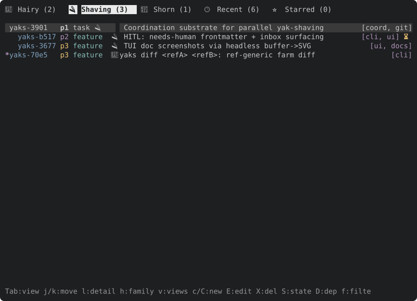
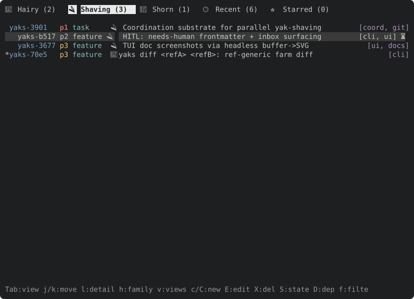
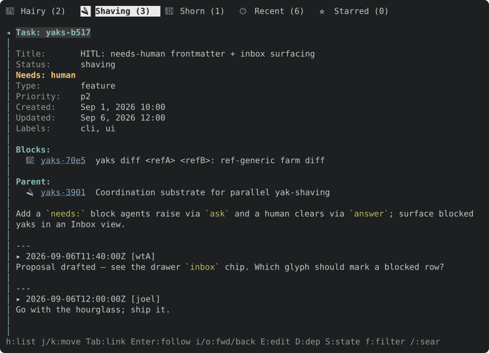

# toque

Drive a [ratatui](https://ratatui.rs) app **headlessly** — from under the hat, so to speak. Instead
of a real terminal, your app renders into an in-memory `TestBackend` buffer; you inject keys over a
tiny line protocol and get back a deterministic, plain-text snapshot after each step.

It does two things, both from a hidden position:

- **Drive** — feed keystrokes (`key j`, `key C-c`, `type hello`, `resize 80 24`).
- **Observe** — emit a text snapshot: a state header (internal facts you choose to expose) and the
  character grid (layout). The text snapshot is the cheap, greppable, diffable channel and carries
  no colour; when you need to *see* a frame, render the same buffer to **SVG**.

Because a frame is a pure function of the app plus the terminal size, the output is deterministic —
good for **agent-driven exploration** of a TUI *and* for `insta`-style **snapshot tests** of any
ratatui UI.

## What it looks like

Here is a short agent session against the [yaks](https://github.com/joelgwebber/yaks) TUI
(`yaks tui --headless --size 96x32`), hunting for the yak that is waiting on a human. The agent
sends one action per line (shown with a leading `>`); toque answers with a framed snapshot.
Blank rows are trimmed and the state headers abridged (`collapsed=` and `filter=` dropped) here for
space.

**1. Switch to the Shaving tab.** The `⏳` badge on `yaks-b517` marks a yak that needs a human.

```text
> key Tab
=== frame 1 · 96x32 · focus=list · view=🪒 Shaving · cursor=0 · rows=4 · sel=yaks-3901 · blocked=[yaks-70e5] · overlay=none ===
 🦬 Hairy (2)   🪒 Shaving (3)   🐑 Shorn (1)   🕒 Recent (6)   ⭐ Starred (0)

 yaks-3901   p1 task     🪒 Coordination substrate for parallel yak-shaving         [coord, git]
   yaks-b517 p2 feature  🪒 HITL: needs-human frontmatter + inbox surfacing         [cli, ui] ⏳
   yaks-3677 p3 feature  🪒 TUI doc screenshots via headless buffer->SVG              [ui, docs]
*  yaks-70e5 p3 feature  🦬 yaks diff <refA> <refB>: ref-generic farm diff                 [cli]
…
=== end ===
```



**2. Move down onto it.** In the text frame only the state header changes (`cursor=1`,
`sel=yaks-b517`), which is exactly what makes it cheap to diff. The highlighted row is colour, so
it only shows up in the SVG.

```text
> key j
=== frame 2 · 96x32 · focus=list · view=🪒 Shaving · cursor=1 · rows=4 · sel=yaks-b517 · blocked=[yaks-70e5] · overlay=none ===
 …same body as frame 1…
=== end ===
```



**3. Open it.** The header now says `focus=detail`, and the body has the question the yak is waiting
on (`Needs: human`).

```text
> key l
=== frame 3 · 96x32 · focus=detail · view=🪒 Shaving · cursor=1 · rows=4 · sel=yaks-b517 · blocked=[yaks-70e5] · overlay=none · detail_scroll=0 · pinned=no ===
 🦬 Hairy (2)   🪒 Shaving (3)   🐑 Shorn (1)   🕒 Recent (6)   ⭐ Starred (0)

◂ Task: yaks-b517
│
│ Title:       HITL: needs-human frontmatter + inbox surfacing
│ Status:      shaving
│ Needs:       human
…
│ ---
│ ▸ 2026-09-06T11:40:00Z [wtA]
│ Proposal drafted — see the drawer `inbox` chip. Which glyph should mark a blocked row?
…
=== end ===
```



The two channels do different jobs. The text frame and its state header are what an agent reads and
diffs, and it costs few tokens. The SVG is what you look at when colour, selection or layout is the
question. Both come from the same in-memory buffer, so they never disagree.

## Quick start

Implement `HeadlessApp`, then drive it:

```rust
use toque::{HeadlessApp, DriverOpts, run};
use ratatui::Frame;
use ratatui::crossterm::event::KeyEvent;

struct MyApp { /* … */ }

impl HeadlessApp for MyApp {
    fn render(&self, f: &mut Frame) { /* draw your widgets */ }
    fn handle_key(&mut self, key: KeyEvent) { /* mutate state */ }
    // optional: on_resize, state_header, should_quit
}

run(MyApp { /* … */ }, DriverOpts { width: 80, height: 24, diff: false }).unwrap();
```

`run` reads the protocol from stdin and writes frames to stdout. For tests, drive a `Session`
directly against any `Write` sink, or skip the protocol entirely with `render_to_buffer` +
`SnapshotEncoder`.

## Protocol

One action per stdin line; a framed snapshot follows each:

```text
key <name>     press one key: a char, or a name (Enter, Esc, Tab, BackTab,
               Space, Backspace, Up/Down/Left/Right, Home, End, PageUp,
               PageDown, Delete). Prefix `C-` for Ctrl (e.g. C-c).
type <text>    type each character of the rest of the line verbatim.
snapshot       re-emit the current frame.
resize <w> <h> change the terminal size.
wait <ms>      let time pass, then re-emit (see below).
quit           exit.
```

### Apps with state of their own

Not every app changes only when a key is pressed: a client of a server gets replies and pushes
whenever they arrive. Two optional hooks cover it:

- `settle(&mut self)` runs before every frame, so the app can absorb what has arrived (and wait
  for the replies its last key asked for). The frame then shows the settled state, not a race.
- `wait(&mut self, Duration)` is what the `wait <ms>` action calls, for what changes on its own
  (a progress bar, a clock). It sleeps by default; an app with its own clock can advance that
  instead, keeping tests instant.

A frame looks like:

```text
=== frame 3 · 80x24 · focus=list cursor=1 … ===
<body: the character grid, one line per row>
=== end ===
```

With `diff: true`, after the first (full) frame only changed body lines are emitted as `L<i>:
<line>` — a large token saving across a multi-step session.

## Visual output (SVG)

The text snapshot deliberately carries no colour — layout plus the state header are what a model
needs for cheap, diffable verification. When you need to *see* a frame (colour, bold/dim, borders),
render the same buffer to a self-contained SVG:

- `render_to_svg(&app, w, h) -> String` — drive and render in one call.
- `buffer_to_svg(&buffer) -> String` — render a buffer you already have.

The SVG is lean and row-ordered: one `<style>` class block for the palette, coalesced background
rects, and one `<text>` per row whose runs are `<tspan>`s pinned by an absolute `x` (a run breaks
after a wide glyph so an emoji can't shove the rest of the row out of column). It embeds directly in
Markdown/HTML and rasterises cleanly to PNG (e.g. via a headless browser) when a pixel image is
wanted — which also lets you control the resolution handed to a vision model.

### PNG output (`png` feature)

An SVG still needs a renderer. With the `png` cargo feature (off by default, so the text and SVG
paths stay light; it pulls in [`resvg`](https://github.com/linebender/resvg)) toque rasterizes
frames itself:

- `render_to_png(&app, w, h) -> Option<Vec<u8>>` — drive, render and return PNG file bytes.
- `svg_to_png(svg: &[u8]) -> Option<Vec<u8>>` — PNG bytes for any SVG source.
- `rasterize_svg(svg: &[u8]) -> Option<Raster>` — straight RGBA8 pixels
  (`Raster { width, height, rgba }`) for callers that want to decode nothing.
- `svg_to_png_scaled(svg, scale: f32)` / `rasterize_svg_scaled(svg, scale)` — the same at `scale` ×
  the SVG's size (`2.0` doubles both dimensions; drawn at the final size, so sharper, not
  upscaled). The unscaled functions are scale `1.0`.

All return `None` for a malformed SVG (and the scaled ones for a `scale` that is not a positive
finite number). Fonts are **embedded** and system fonts are never loaded, so a frame looks the same
on every machine and still has its text on a host with no monospace font:

- **DejaVu Sans Mono**, four faces (regular, bold, oblique, bold oblique), so `Modifier::BOLD` and
  `Modifier::ITALIC` draw. Covers Basic Latin, Latin-1, Latin Extended-A, General Punctuation,
  Arrows, Mathematical Operators, Miscellaneous Technical, Box Drawing, Block Elements, Geometric
  Shapes, Miscellaneous Symbols, Dingbats and Braille Patterns (borrowed from DejaVu Sans, shifted
  into the mono cell), plus currency, letterlike and super/subscript symbols. Every face covers the
  same codepoints, so one symbol never changes the face of the text around it.
- **Noto Color Emoji** (COLRv1), a common subset (~250 emoji: emoticons, status marks such as
  ✅ ❌ ⭐ ⚡, hands, files and tools, animals). Skin tones, flags and ZWJ sequences are not
  included: a sequence draws as its parts.
- A character no embedded face has (Powerline/Nerd Font glyphs, CJK, rarer emoji) draws as a
  **box** (DejaVu's `.notdef`), never blank, so a hole in a frame is visible. DejaVu has no
  Powerline glyphs, and no other font is embedded.

The subsets are generated, not hand-made: `scripts/subset_fonts.py` lists the ranges, downloads
the pinned sources (DejaVu 2.34, Noto Color Emoji COLRv1) and runs `pyftsubset`'s subsetter;
`--emoji base` builds the full Unicode 15 base emoji set (1.8 MB instead of 0.25 MB). Licenses and
provenance are in `assets/fonts/`.

## For the live terminal

toque also holds the parts our ratatui apps share when they run in a real terminal, each behind a
cargo feature so a consumer pulls in only what it uses.

### Theme surfaces (`theme` feature)

A highlight band (a selected row, a line cursor, a pinned header) has to be a background, and any
fixed grey is wrong on one of dark or light terminals. `toque::theme` derives the bands from the
terminal's own colours instead: its background blended a little toward its foreground.

- `theme::init("MYAPP_THEME")` — once at startup, in raw mode, before reading any event. It
  asks the terminal for its colours (OSC 10/11, via
  [`terminal-colorsaurus`](https://github.com/bash/terminal-colorsaurus)); `MYAPP_THEME=dark|light`
  overrides, and `COLORFGBG` is the fallback, then dark.
- `theme::selected()` / `theme::band()` — the strong and the quiet band, as a `Color`: truecolor
  when `COLORTERM` says so, else the nearest xterm-256 index.
- `theme::with_terminal(bg, fg, || ...)` — draw as if the terminal had these colours (per thread),
  for tests and doc frames of a light theme.

Without `init` (tests, headless frames) the bands are the dark greys `Indexed(237)` and
`Indexed(236)`, so snapshots never depend on the machine. The rule that goes with it: foregrounds
stay the 16 ANSI colours, named by role in the app's own palette, so the user's theme picks the
hues.

> **History.** toque previously offered three *text* style-encodings (`spans`/`interleaved`/
> `parallel`) that packed per-cell colour into the snapshot. They were retired once SVG became the
> visual channel: SVG renders style natively and better, and the semantic style that matters
> (selection, focus, blocked) already rides in the state header as plain facts. The original
> evaluation that picked `spans` is kept for the record at
> [`docs/research/tui-style-eval.md`](https://github.com/joelgwebber/yaks/blob/main/docs/research/tui-style-eval.md).

## Status

Extracted from the [yaks](https://github.com/joelgwebber/yaks) TUI, its first consumer;
[canon](https://github.com/joelgwebber/canon)'s TUI is the second.
Pre-1.0: the API may shift as more apps adopt it.

## License

Apache-2.0.
